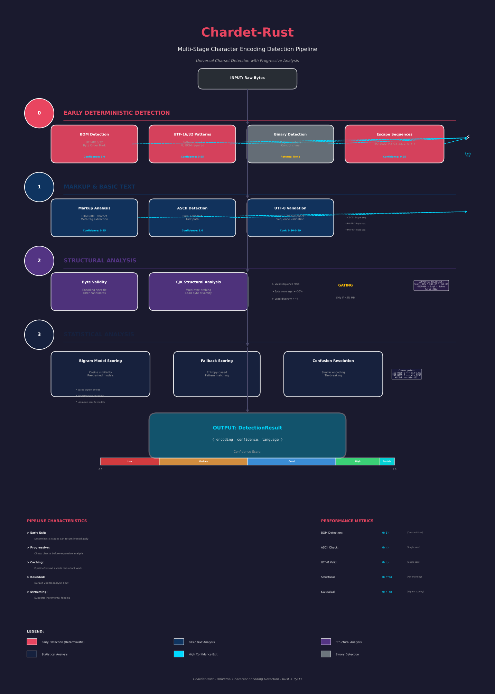

# chardet-rust

Universal character encoding detector — Rust-powered fork of [chardet 7.0](https://github.com/chardet/chardet).

[](LICENSE)
[](https://pypi.org/project/chardet-rust/)

> [!NOTE]
> This is a fork of the [chardet 7.0 rewrite](https://github.com/chardet/chardet).
> It is published as `chardet-rust` on PyPI and is **not** an official release of the upstream `chardet` project.

> [!WARNING]
> The upstream chardet 7.0 rewrite is an AI experiment and is not an official upstream replacement.

> [!NOTE]
> This Rust port was created to the most part with [Kimi](https://www.kimi.com/) (Kimi 2.5).

## Performance

**99.7% accuracy** on 3,137 test files — the same files the reference chardet
7.7.0 gets right. **2.3x faster** than chardet 7.7.0 (mypyc), the build
`pip install chardet` gives you, and **2.8x faster** than charset-normalizer.
Language detection for every result. LGPL licensed.

|                              | chardet-rust | chardet 7.7.0 (mypyc) | [charset-normalizer] 3.5.2 | cchardet 3.2.0 |
| ---------------------------- | :----------: | :-------------------: | :------------------------: | :------------: |
| Accuracy (3,137 files)       |   **99.7%**  |         99.7%         |           81.7%            |     60.1%      |
| Speed                        | **4,394/s**  |       1,907/s         |          1,545/s           |    2,614/s     |
| Median per file              |  **0.07ms**  |        0.23ms         |           0.45ms           |     0.07ms     |
| Language detection           |   **88.5%**  |         93.0%         |             --             |       --       |
| RSS after import             |  **193.5MiB**|        157.0MiB       |          248.0MiB          |    181.8MiB    |

Measured on CPython 3.13.9 (macOS aarch64) with
[`scripts/compare_detectors.py`](scripts/compare_detectors.py). Method,
runtime distribution and the pure-Python/chardet-6.0.0 baselines are in
[`docs/performance.rst`](docs/performance.rst).

[charset-normalizer]: https://github.com/jawah/charset_normalizer

## Installation

```bash
pip install chardet-rust
```

For source builds (or editable local development), install a Rust toolchain as
well, because the extension module is built from `rust/` with `setuptools-rust`.

## Quick Start

```python
import chardet

# Plain ASCII is reported as its superset Windows-1252 by default,
# keeping with WHATWG guidelines for encoding detection.
chardet.detect(b"Hello, world!")
# {'encoding': 'Windows-1252', 'confidence': 1.0, 'language': 'en'}

# UTF-8 with typographic punctuation
chardet.detect("It\u2019s a lovely day \u2014 let\u2019s grab coffee.".encode("utf-8"))
# {'encoding': 'utf-8', 'confidence': 0.99, 'language': 'es'}

# Japanese EUC-JP
chardet.detect("これは日本語のテストです。文字コードの検出を行います。".encode("euc-jp"))
# {'encoding': 'euc-jis-2004', 'confidence': 1.0, 'language': 'ja'}

# Get all candidate encodings ranked by confidence
text = "Le café est une boisson très populaire en France et dans le monde entier."
results = chardet.detect_all(text.encode("windows-1252"))
for r in results:
    print(r["encoding"], r["confidence"])
# windows-1252 0.44
# iso-8859-15 0.44
# mac-roman 0.42
# cp858 0.42
```

### Streaming Detection

For large files or network streams, use `UniversalDetector` to feed data incrementally:

```python
from chardet import UniversalDetector

detector = UniversalDetector()
with open("unknown.txt", "rb") as f:
    for line in f:
        detector.feed(line)
        if detector.done:
            break
result = detector.close()
print(result)
```

## How It Works

chardet uses a multi-stage detection pipeline that progresses from cheap deterministic checks to more expensive statistical analysis:



The pipeline includes: BOM detection, UTF-16/32 pattern analysis, escape sequence detection, binary detection, markup charset extraction, ASCII check, UTF-8 validation, byte validity filtering, CJK structural analysis, statistical scoring with bigram models, and post-processing for confusion resolution.

See the [full documentation](https://chardet.readthedocs.io/) for details.

### Encoding Era Filtering

Restrict detection to specific encoding eras to reduce false positives:

```python
from chardet import detect_all
from chardet.enums import EncodingEra

data = "Москва является столицей Российской Федерации и крупнейшим городом страны.".encode("windows-1251")

# All encoding eras are considered by default — 4 candidates across eras
for r in detect_all(data):
    print(r["encoding"], round(r["confidence"], 2))
# windows-1251 0.5
# mac-cyrillic 0.47
# kz-1048 0.22
# ptcp154 0.22

# Restrict to modern web encodings — 1 confident result
for r in detect_all(data, encoding_era=EncodingEra.MODERN_WEB):
    print(r["encoding"], round(r["confidence"], 2))
# windows-1251 0.5
```

## CLI

```bash
chardetect somefile.txt
# somefile.txt: utf-8 with confidence 0.99

chardetect --minimal somefile.txt
# utf-8

# Pipe from stdin
cat somefile.txt | chardetect
```

## What's in chardet 7.0 (upstream)

- **Rust reimplementation of the detector core** — the full detection pipeline is implemented in `rust/src` and exposed to Python via `chardet_rs._chardet_rs` (PyO3)
- **Python API compatibility layer** — `detect()`, `detect_all()`, `UniversalDetector`, and `chardetect` keep the familiar chardet API while delegating execution to Rust
- **12-stage detection pipeline** — BOM detection, structural probing, byte validity filtering, and bigram statistical models are now executed in native code
- **2.3x faster** than chardet 7.7.0 (mypyc), **2.8x faster** than charset-normalizer
- **99.7% accuracy** — identical to the reference chardet 7.7.0 file for file, +18.0pp vs charset-normalizer
- **Language detection** — 88.5% accuracy, returned with every result
- **99 encodings** — full coverage including EBCDIC, Mac, DOS, and Baltic/Central European families
- **`EncodingEra` filtering** — scope detection to modern web encodings, legacy ISO/Mac/DOS, mainframe, or all
- **Thread-safe detection calls** — `detect()` and `detect_all()` are safe to call concurrently; `UniversalDetector` is per-thread

## License Discussion

There is an active licensing dispute around the upstream chardet 7.0 AI-assisted rewrite.

### Timeline

- On **March 4, 2026**, [issue #327](https://github.com/chardet/chardet/issues/327) was opened by a user identifying as Mark Pilgrim (original chardet author), arguing that relicensing from LGPL to MIT is not permitted.
- On **March 6, 2026**, [The Register article](https://www.theregister.com/2026/03/06/ai_kills_software_licensing/) reported the dispute and included statements from multiple people in the OSS ecosystem.

### Core Disagreement

- **Relicensing claim:** maintainers stated the new version is a sufficiently new implementation and can be MIT-licensed.
- **Derivative-work claim:** critics argue the rewrite remains derivative of prior LGPL work because of project continuity, prior code exposure, and intentional API/behavior compatibility.
- **Clean-room dispute:** one side treats AI-assisted regeneration plus low similarity metrics as evidence of independence; the other side argues that AI training provenance and maintainer prior exposure weaken clean-room arguments.

### Points Raised in Public Discussion

- Similarity analysis (for example, references to JPlag comparisons) was cited as evidence that 7.0 differs structurally from prior versions.
- Counterarguments focused less on line-by-line similarity and more on copyright/licensing doctrine for derivative works.
- Broader concerns were raised about whether AI-assisted rewrites could undermine copyleft obligations in practice.
- The Register also framed this as part of a larger unresolved legal question: how copyright and licensing apply when code is heavily AI-assisted.

### Current Status

- The disagreement is public and unresolved.
- This repository includes this summary for transparency and context.
- If licensing compliance is material to your use case, obtain legal advice before adoption.

This section is informational only and is not legal advice.

## License

[LGPL](LICENSE)
